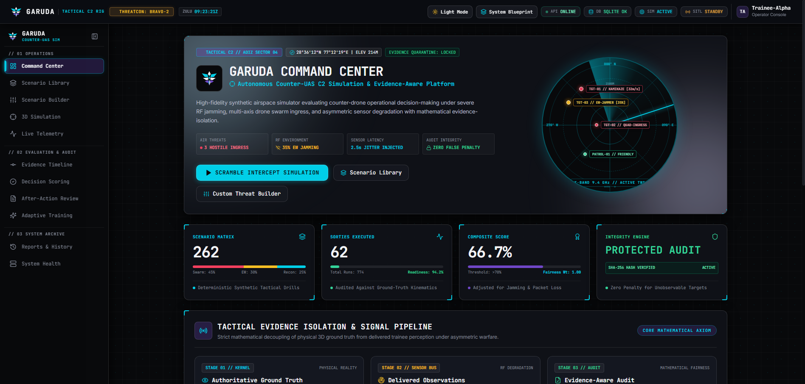
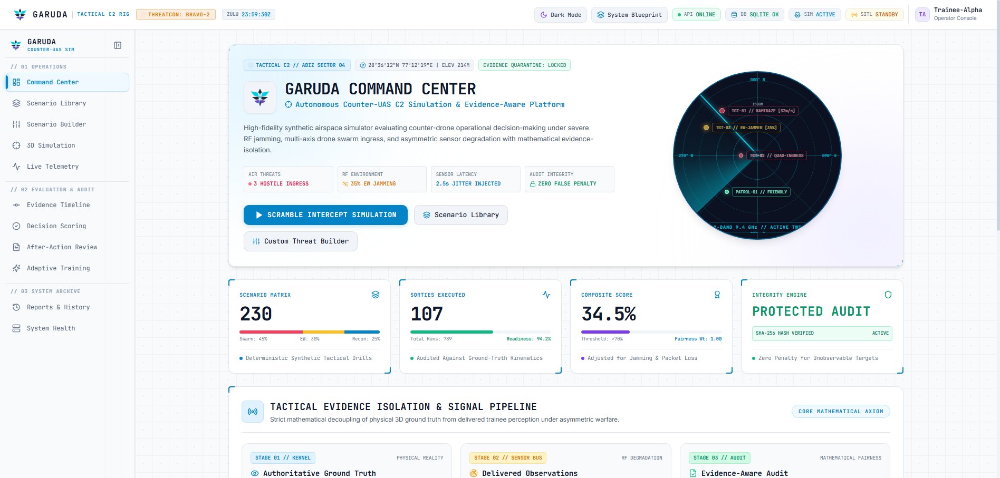
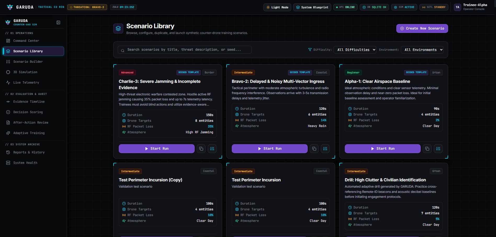
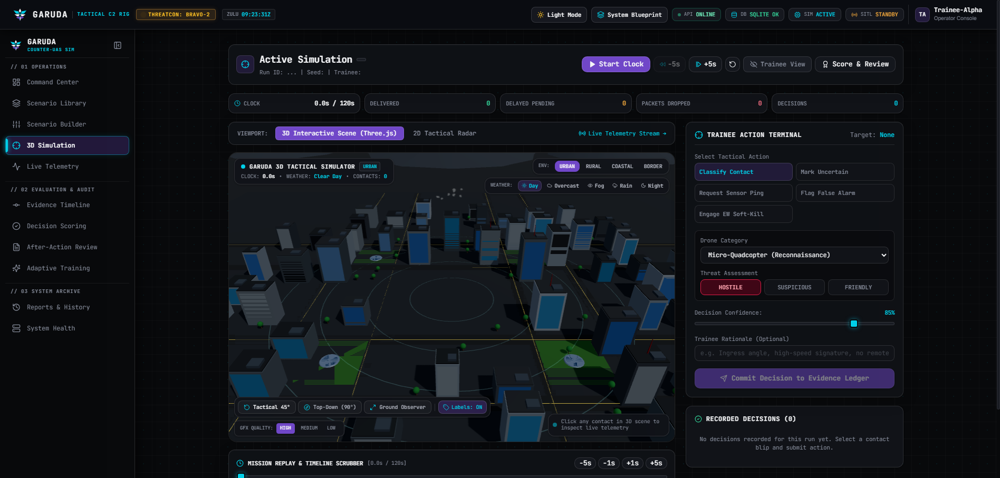
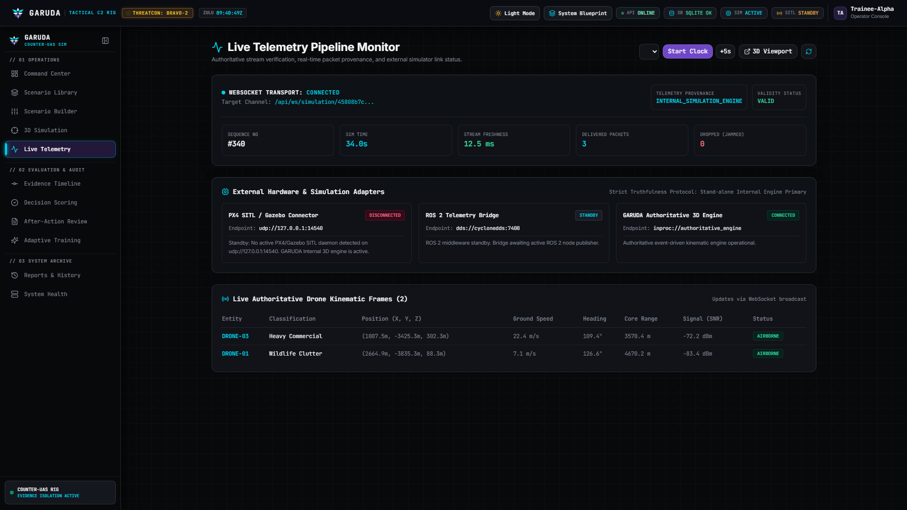
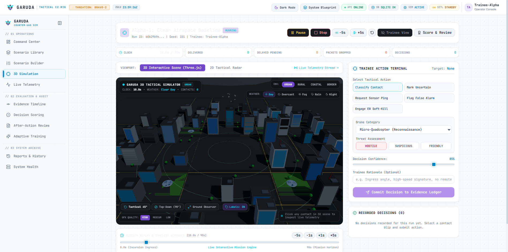
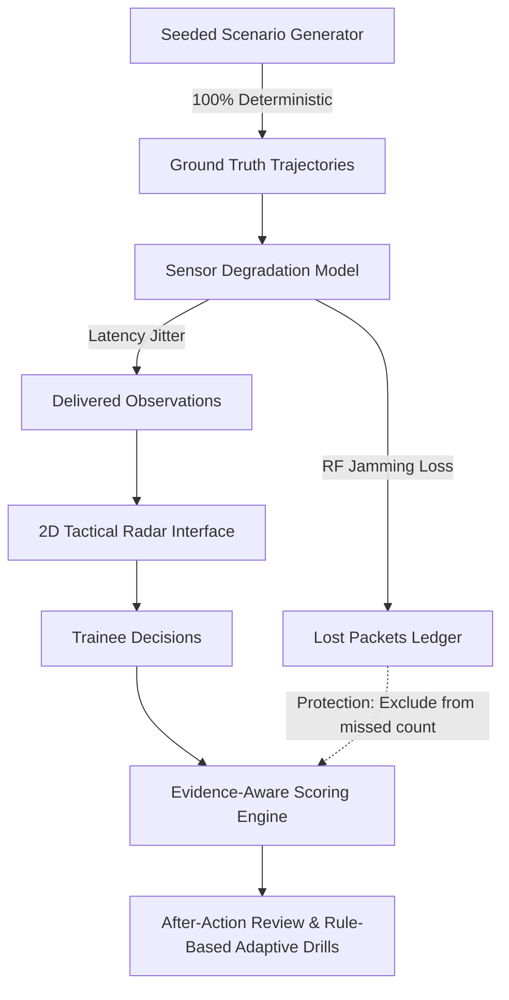

# GARUDA — AI-Enabled Drone & Counter-Drone Threat Simulation Trainer

<p align="center">
  
</p>

[](#)
[](#)
[](#)
[](#)

> **GARUDA** is an end-to-end mission simulation trainer that generates repeatable synthetic drone-threat scenarios, presents degraded sensor observations, evaluates trainee decisions fairly under incomplete information, and recommends targeted adaptive follow-up training.

---

## Visual Demo Showcase (Live Telemetry & Dual Theme UI)

### 🌓 Dual-Theme Tactical C2 Interface (Dark & Daylight White)

| Command Center (Tactical Dark Mode) | Command Center (Crisp White Theme) |
| :---: | :---: |
|  |  |

| Scenario Library (Dark Mode) | 3D Simulation Workspace (Dark Mode) |
| :---: | :---: |
|  |  |

### 🛰️ Live Telemetry & 3D Sensor Pipelines

| Live Telemetry Pipeline Monitor | 3D Interactive Simulation Workspace (Light) |
| :---: | :---: |
|  |  |

---

## 1. The Core Innovation: Evidence-Driven Adaptive Training

Conventional counter-drone simulators evaluate trainees by checking actions directly against ground truth. Under electronic warfare, sensor latency, or packet loss, this results in unfair penalties for unobservable events and rewards blind guessing.

GARUDA introduces a **3-Layer Separation Architecture**:
1. **Simulated Ground Truth:** True drone trajectories, payload events, and classifications inside the synthetic physics simulation. Strictly isolated from the trainee.
2. **Delivered Observations:** Sensor frames delivered over a degraded data link subject to transmission latency jitter, RF jamming packet loss, and measurement noise.
3. **Trainee Decisions & Evidence Ledger:** Recorded with timestamps and audited against the evidence available at that exact millisecond. Missing observations never penalize the trainee.



---

## 2. Technology Stack

- **Backend:** Python 3.12, FastAPI, SQLAlchemy 2.0, Pydantic V2, SQLite (dev fallback) / PostgreSQL (production)
- **Frontend:** React 18, TypeScript, Vite, Tailwind CSS, Lucide React, Recharts
- **Simulation Engine:** Modular Python event-driven deterministic simulation with seeded PRNG
- **Testing:** pytest with 100% pass rate covering isolation, degradation, and scoring
- **Deployment:** Docker & Docker Compose multi-service stack

---

## 3. Quick Start (Local Development)

### Prerequisites
- Python 3.11+
- Node.js 18+ and npm

### Step 1: Start Backend
```bash
cd backend
python -m venv .venv
# On Windows:
.\.venv\Scripts\Activate.ps1
# On Linux/macOS:
# source .venv/bin/activate

pip install -r requirements.txt
uvicorn app.main:app --reload --port 8000
```
*The backend automatically creates tables and seeds the 3 demonstration scenarios on first run.*
- API Documentation: [http://localhost:8000/docs](http://localhost:8000/docs)
- Health Check: [http://localhost:8000/api/health](http://localhost:8000/api/health)

### Step 2: Start Frontend
In a new terminal:
```bash
cd frontend
npm install
npm run dev
```
Open your browser at [http://localhost:5173](http://localhost:5173).

---

## 4. Run With Docker Compose

To launch the full production stack (PostgreSQL + FastAPI + React/Nginx):
```bash
docker-compose up --build
```
- Web Application: [http://localhost:3000](http://localhost:3000)
- Backend API: [http://localhost:8000](http://localhost:8000)

---

## 5. Running Automated Tests

Run the comprehensive unit and integration test suite:
```bash
cd backend
.\.venv\Scripts\pytest.exe -v tests
```
The test suite verifies:
- Scenario creation & duplication
- Seeded scenario generation
- 100% deterministic ground truth reproducibility
- Ground truth isolation (trainee view vs evaluator mode)
- Observation degradation (delayed & lost packet handling)
- Evidence-aware scoring with protected zero-denominators
- JSON and CSV report export formats

---

## 6. Application Pages & Features

| Page | Route | Description |
| :--- | :--- | :--- |
| **Command Center** | `/` | Operational overview, live KPIs, core innovation showcase, quick drill launcher. |
| **Scenario Library** | `/scenarios` | Search, filter, duplicate, and launch seeded demonstration scenarios. |
| **Scenario Builder** | `/scenarios/builder` | Configure drone entity count, delay jitter, packet loss rate, and atmospheric presets. |
| **Simulation Workspace** | `/simulation` | Interactive 2D tactical radar display, clock controls, target selection, and trainee decision panel. |
| **Evidence Timeline** | `/timeline` | Chronological audit ledger linking ground truth, delayed/lost packets, and trainee decisions. |
| **Decision Scoring** | `/scoring` | Transparent mathematical scoring breakdown with decision-by-decision evidence audit. |
| **After-Action Review** | `/review` | Mission debrief with strengths, improvement targets, and functional JSON/CSV exports. |
| **Adaptive Training** | `/training` | Rule-based performance gap diagnosis with 1-click tailored drill generator. |
| **Reports & History** | `/reports` | Searchable historical mission archives and export downloads. |

---

## 7. Demonstration Scenarios

Three pre-seeded scenarios are ready for operational training and evaluation:
1. **Alpha-1: Clear Airspace Baseline** (Beginner): Prompt delivery, 2% loss rate, ideal for baseline calibration.
2. **Bravo-2: Delayed & Noisy Multi-Vector Ingress** (Intermediate): Heavy rain, 3.2s average delay, 14% packet loss.
3. **Charlie-3: Severe Jamming & Incomplete Evidence** (Advanced): High RF jamming, 35% packet loss, 5.5s delay. Trainees must exercise evidence verification.

For the full evaluation script, see [docs/demo-script.md](file:///c:/garuda/docs/demo-script.md).

---

## 8. Documentation Index

- [Architecture & Diagrams](file:///c:/garuda/docs/architecture.md)
- [Simulation & Sensor Degradation Model](file:///c:/garuda/docs/simulation-model.md)
- [Evidence-Aware Scoring Methodology](file:///c:/garuda/docs/scoring-methodology.md)
- [REST API Guide](file:///c:/garuda/docs/api-guide.md)
- [Evaluator Demo Walkthrough](file:///c:/garuda/docs/demo-script.md)

---
*GARUDA — Autonomous Counter-UAS Simulation & Evaluation Platform.*
