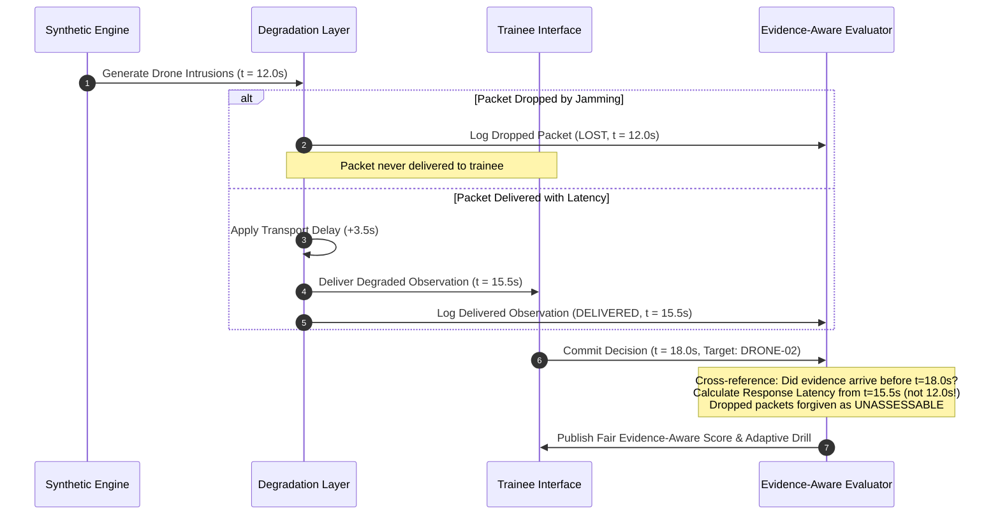
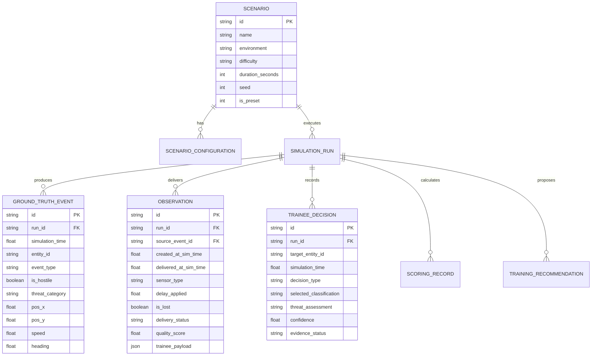

# GARUDA — System Architecture & Technical Specifications

**Project Name:** GARUDA (Generative AI for Realistic Unmanned-threat Detection and Assessment)  
**Problem Statement ID:** SIH26247  
**Team:** DareDevils  
**Domain:** Robotics and Drones  

---

## 1. System Architecture Overview

The following high-level system architecture illustrates the six interconnected functional subsystems forming GARUDA's end-to-end training and evaluation pipeline, backed by an integrated Data Layer and Continuous Feedback Loop.

```mermaid
flowchart LR
    subgraph S1["1. Scenario & Environment Generator"]
        direction TB
        S1A["Scenario Library (JSON/YAML)"]
        S1B["Environment Models (Urban, Rural, Coastal, Border)"]
        S1C["Weather & Time (Day/Night, Fog, Rain, Jamming)"]
        S1D["Difficulty Levels (Beginner → Advanced)"]
        S1E["Scenario Configurator (Custom Seed & Physics)"]
    end

    subgraph S2["2. Simulation Engine"]
        direction TB
        S2A["Containerized Orchestration (Docker)"]
        S2B["Kinematic Flight Models (PX4 / Seeded Engine)"]
        S2C["Tactical Grid Coordinates (Virtual Arena)"]
        S2D["Deterministic Threat Generator"]
    end

    subgraph S3["3. Observation & Comm Delay Simulator"]
        direction TB
        S3A["Sensor Models (Radar, RF, EO/IR, Acoustic)"]
        S3B["Network Simulation (Latency Jitter, Packet Drop)"]
        S3C["Sensor Fusion (Multi-source Telemetry Payload)"]
        S3D["Event Streaming & Strict Isolation Buffer"]
    end

    subgraph S4["4. Trainee Interface"]
        direction TB
        S4A["React + TypeScript Tactical Terminal"]
        S4B["Interactive 2D Tactical Radar & Blips"]
        S4C["Trainee Decision Terminal (Classify / Ping / Uncertain)"]
        S4D["FastAPI REST & WebSocket Backend"]
    end

    subgraph S5["5. Decision Scoring Engine"]
        direction TB
        S5A["Evidence-Aware Evaluation Logic (Python)"]
        S5B["Threat Classification & Corroboration Engine"]
        S5C["Protected Denominator Formulations"]
        S5D["Multi-Factor Metrics (Detection, Accuracy, Latency, Discipline)"]
    end

    subgraph S6["6. After-Action Review & Adaptive Training"]
        direction TB
        S6A["Mission Executive Debrief (AAR)"]
        S6B["Strengths & Vulnerability Diagnosis"]
        S6C["JSON & CSV Audit Ledger Export"]
        S6D["Rule-Based Adaptive Drill Curriculum"]
    end

    S1 -->|Scenario Inputs| S2
    S2 -->|UAV Telemetry| S3
    S3 -->|Sensor Observations| S4
    S4 -->|Trainee Actions| S5
    S5 -->|Scoring Ledger| S6
    S6 ==>|Continuous Feedback Loop: Tailored Drills| S1

    subgraph DL["Data Layer (Storage & Management)"]
        direction LR
        D1["PostgreSQL / Relational Store (Scenarios, Runs, Decisions, Scores)"]
        D2["Evidence & Observation Ledgers (Telemetry, Delays, Packet Drops)"]
        D3["Report Archives (JSON Mission Reports, CSV Audit Ledgers)"]
    end

    S1 <--> DL
    S2 <--> DL
    S3 <--> DL
    S4 <--> DL
    S5 <--> DL
    S6 <--> DL
```

---

## 2. Functional Subsystems & Implementation Mapping

| Architecture Subsystem | Implemented Prototype Modules | Production Extension Path |
| :--- | :--- | :--- |
| **1. Scenario & Environment Generator** | [`app/models/scenario.py`](file:///c:/garuda/backend/app/models/scenario.py), [`app/api/scenarios.py`](file:///c:/garuda/backend/app/api/scenarios.py), `ScenarioBuilder.tsx` | YAML/JSON preset files, GIS elevation maps, seasonal weather APIs |
| **2. Simulation Engine (Drone Models)** | [`app/engine/generator.py`](file:///c:/garuda/backend/app/engine/generator.py), [`app/engine/service.py`](file:///c:/garuda/backend/app/engine/service.py) with seeded PRNG | PX4 Autopilot SITL, Gazebo 3D simulation, ROS 2 middleware bridge |
| **3. Observation & Comm Delay Simulator** | [`app/engine/degradation.py`](file:///c:/garuda/backend/app/engine/degradation.py), [`app/api/observations.py`](file:///c:/garuda/backend/app/api/observations.py) | Apache Kafka telemetry streams, ns-3 RF network simulation |
| **4. Trainee Interface (Decision Making)** | `SimulationWorkspace.tsx`, `TacticalRadarCanvas.tsx`, [`app/main.py`](file:///c:/garuda/backend/app/main.py) | Multi-station defense center consoles, WebSocket push streams |
| **5. Decision Scoring Engine** | [`app/scoring/evaluator.py`](file:///c:/garuda/backend/app/scoring/evaluator.py), [`app/api/evaluation.py`](file:///c:/garuda/backend/app/api/evaluation.py) | scikit-learn anomaly classifiers, OpenCV EO/IR computer vision verification |
| **6. After-Action Review & Adaptive Training** | `AfterActionReview.tsx`, `AdaptiveTraining.tsx`, [`app/recommender/engine.py`](file:///c:/garuda/backend/app/recommender/engine.py) | Grafana analytics dashboards, Metabase BI, automated LMS sync |
| **Data Layer** | PostgreSQL (`garudadb`), SQLite fallback, SQLAlchemy ORM | MinIO object store for flight logs, Redis for distributed real-time caching |

---

## 3. The Core Innovation: Evidence Isolation Protocol

Conventional simulators compare trainee decisions directly against ground truth, which produces two major failures:
1. **Unfair Penalties:** Trainees are marked as "failed detection" when a drone's telemetry was 100% lost due to hostile jamming or transmission lag.
2. **Rewarding Blind Guessing:** Trainees who fire randomly on unconfirmed radar noise can accidentally hit a target without corroborated evidence.

GARUDA formalizes an **immutable 3-layer ledger**:
- **Ground Truth Ledger:** Strictly isolated inside the backend. Never leaks to trainee terminal during active simulations.
- **Degradation Ledger:** Records which packets suffered latency ($\Delta t_{delay}$) or were dropped (`is_lost = True`).
- **Trainee Decision Ledger:** Evaluated against only observations delivered on or before $t_{decision}$.

---

## 4. Relational Database Schema

